# Design: rbac-access-control

> **Estado:** Etapa 1 aprobada. Etapa 2 (migración) implementada, **SQL generado offline, sin aplicar** a la base real (pendiente de aprobación del usuario).
> Contrato de API: fuente única en `api-contract.md` (borrador; se cierra en etapa 6).

## Respuestas del usuario (etapa 1)

| # | Decisión |
|---|---|
| P1 | Opción (a): `admin → is_superuser = 1`; `operator → is_superuser = 0`. El seed (etapa 3) crea el grupo **"Operadores"** con el rol **"Operador"** = todos los permisos de negocio **menos** `rbac:manage` y **menos** `orders:delete`. |
| P2 | Se agrega `users.updated_at`, backfill `= created_at`. |
| P3 | `user_roles` usa `assigned_at`/`assigned_by` (en lugar de `created_*`) + `updated_at`/`updated_by`. |
| P4 | ON DELETE aprobados tal cual: grupo CASCADE en puentes; rol en uso RESTRICT → 409 `ROLE_IN_USE`. |
| P5 | Se mantiene `groups`; SQL crudo con backticks (incluido `conftest.py`). |
| P6 | `permission_required(A, B)` = AND (todos). |
| P7 | `is_superuser` **no** se modifica por API; solo seed/CLI. |
| P8 | Se autoriza modificar `conftest.py` (`is_superuser=True` en id=1, truncado de tablas nuevas con backticks). Ningún test existente se cambia. |
| P9 | `users.role` queda deprecada y sigue en login y `/me`; se borra en un cambio futuro. |
| P10 | Usuario inactivo → 401 aunque sea superusuario. |

Decisiones adicionales acordadas con el plan de frontend (`frontend-plan.md`):
- Permisos de la sección de seguridad: solo `rbac:read` (lecturas) y `rbac:manage` (escrituras). No hay `rbac:users:read`.
- Errores con `code` además de `error`: `SELF_LOCKOUT` (409), `ROLE_IN_USE` (409), `SELF_ASSIGNMENT`.
- **No** hay bloqueo `LAST_ADMIN` (lo cubre el superusuario).
- Listado de usuarios sin paginación.
- Acceso efectivo: `GET /api/rbac/users/<id>/access` (no `/effective-access`).
- Habrá un test backend que compare `frontend/src/features/security/permissions/perms.js` con el enum `Perm` (etapa 3 o 4). Formato acordado: una entrada por línea dentro de `export const PERM = Object.freeze({ ... })`, `NOMBRE_MIEMBRO: 'recurso:acción',`, con nombres iguales a los miembros del enum Python.
- `GET /api/auth/me/permissions` es contrato **fijo** (el frontend ya lo consume): ver `api-contract.md` §1.
- `orders:read` existe en el catálogo (etapa 3); los recursos usan el nombre del endpoint en inglés (`orders`, no `ordenes`).

## Etapa 2 — Migración (hecho)

- `backend/app/auth/models.py`: `User.is_superuser` (`BOOL NOT NULL DEFAULT 0`), `User.updated_at` (`DATETIME NOT NULL DEFAULT CURRENT_TIMESTAMP`, `onupdate`). `role` marcada deprecada en comentario; `to_dict()` sin cambios.
- `backend/app/rbac/__init__.py`, `backend/app/rbac/models.py`: `Group`, `Role`, `Permission`, `UserGroup`, `GroupRole`, `UserRole`, `RolePermission`. Sin relationships ORM todavía (se agregan en etapa 5 si las consultas lo requieren).
- `backend/app/__init__.py`: importa `app.rbac.models` (necesario para `create_all` y autogenerate).
- `backend/migrations/versions/44a4db68ccde_add_rbac_tables.py` (`down_revision = c8c9b0e3a953`): escrita a mano (no autogenerate, para no conectar a la base real). Incluye backfill `is_superuser` y `updated_at`. Downgrade: `DROP TABLE` en orden inverso + `drop_column` de las 2 columnas de `users` (los índices caen con la tabla; dropearlos antes fallaría porque MySQL los exige para las FK).
- Paridad modelo ↔ migración verificada compilando el DDL de los modelos con el dialecto MySQL: mismos nombres de FK (`fk_<tabla>_<col>`), `ondelete`, UNIQUE, CHECK, índices y `server_default`.
- Timestamps nuevos con `server_default CURRENT_TIMESTAMP` además del default Python, para que filas insertadas por SQL crudo (seed/migración) no fallen.
- `backend/tests/conftest.py`: usuario id=1 con `is_superuser=True`; `_clean_tables` trunca las 7 tablas nuevas y usa backticks en todos los `TRUNCATE`.
- SQL offline generado y revisado (sin aplicar): `flask db upgrade c8c9b0e3a953:44a4db68ccde --sql` y `flask db downgrade 44a4db68ccde:c8c9b0e3a953 --sql`. Contiene 2 CHECK, 16 índices secundarios, 20 FK con `ON DELETE` explícito y los 2 `UPDATE users` de backfill.
- Suite completa con modelos nuevos sobre la base de test: **234 passed** (verificado en el worktree `feat/rbac`).
- ⚠️ **Despliegue:** el contenedor `delivery3d-backend` monta el repo en vivo. Cambiar `User` sin aplicar la migración rompe el login (`Unknown column users.is_superuser`). Por eso el trabajo vive en el worktree `.worktrees/rbac` (rama `feat/rbac`) y el orden de despliegue es: **primero `flask db upgrade`, después el código**.
- ⚠️ El downgrade borra `is_superuser`/`updated_at` y todas las asignaciones RBAC (pérdida de datos esperable en un downgrade de tablas nuevas). `users.role` no se toca, así que un re-upgrade reconstruye `is_superuser` desde `role`.

## Involved Files (real paths)
Relevados para esta etapa (no se modifican en la etapa 1):
- `backend/app/auth/models.py` — `User` (`id`, `username`, `password_hash`, `role VARCHAR(20)`, `is_active`, `created_at`; **sin** `is_superuser` ni `updated_at`).
- `backend/app/auth/security.py` — `generate_jwt_token` (claims `sub`, `username`, `role`, `iss`, `iat`, `exp`), `login_required` (setea `g.current_user_id`, `g.current_user`), `roles_required(*roles)` (**sin uso en ninguna ruta**).
- `backend/app/__init__.py` — factory, orden de import de modelos, registro de blueprints.
- Blueprints: `backend/app/{orders,cashbox,printers,settings,materials,filaments,auth}/routes.py` (todos con `@login_required` únicamente).
- `backend/migrations/versions/` — cabeza actual `8b56eb6b8347 → 411d9c4af9cc → c8c9b0e3a953` (`add_role_and_is_active_to_users`, última).
- `backend/tests/conftest.py` — `db.create_all()` (los tests **no** usan migraciones), `_clean_tables` con `TRUNCATE TABLE {table}` sin comillas, usuario fixture `User(id=1, role="admin")`, `make_token`, `auth_headers`.
- `backend/seeds/seed_operator.py` — crea/actualiza el usuario id=1 con `role="admin"`.
- `openspec/archive/2026-09-18-order-deletion/spec-delta.md` — "cualquier operador autenticado" puede borrar pedidos en cualquier estado.

Previstos para etapas siguientes (paths a confirmar en cada etapa):
- `backend/app/rbac/{__init__,models,constants,services,security,schemas,routes}.py`
- `backend/migrations/versions/<rev>_add_rbac_tables.py`
- `backend/seeds/seed_permissions.py`
- `backend/tests/rbac/`
- `openspec/changes/rbac-access-control/spec-delta.md`

---

## Etapa 1 — Modelo de datos

### Convenciones aplicadas (tomadas del código existente)
- PK `INT AUTO_INCREMENT` llamada `id` en **todas** las tablas, incluidas las puente (igual que `order_items`, `cash_movements`; no hay PK compuestas en el repo). La unicidad del par se garantiza con `UNIQUE`.
- Tablas en plural, snake_case; constraints con nombre explícito (`uq_<tabla>_<cols>`, `ix_<tabla>_<col>`, `chk_<tabla>_<regla>`, `fk_<tabla>_<col>`), como `chk_printers_power_watts` / `ix_printers_is_active`.
- Fechas `DATETIME` en UTC con default `_utcnow` en Python y `onupdate` para `updated_at` (patrón de `printers` y `workshop_settings`).
- Charset `utf8mb4_unicode_ci`, InnoDB.
- FKs hacia `users` en el repo no declaran `ondelete` (= `RESTRICT`/`NO ACTION`): `orders.user_id`, `order_status_history.changed_by`, `cash_movements.user_id`. Los usuarios no se borran físicamente; se desactivan con `is_active = 0`.

### Diagrama

```mermaid
erDiagram
    users {
        INT id PK "AUTO_INCREMENT"
        VARCHAR(80) username UK "uq users.username (existente)"
        VARCHAR(255) password_hash "NOT NULL (existente)"
        VARCHAR(20) role "existente - DEPRECADA, no se usa para autorizar"
        TINYINT(1) is_active "NOT NULL DEFAULT 1 (existente)"
        TINYINT(1) is_superuser "NUEVA - NOT NULL DEFAULT 0"
        DATETIME created_at "NOT NULL (existente)"
        DATETIME updated_at "NUEVA (a confirmar) - NOT NULL, backfill = created_at"
    }

    groups {
        INT id PK "AUTO_INCREMENT"
        VARCHAR(100) name UK "uq_groups_name - NOT NULL"
        VARCHAR(255) description "NULL"
        DATETIME created_at "NOT NULL"
        DATETIME updated_at "NOT NULL, onupdate"
        INT created_by FK "NULL = sistema - ix_groups_created_by - ON DELETE RESTRICT"
        INT updated_by FK "NULL = sistema - ix_groups_updated_by - ON DELETE RESTRICT"
    }

    roles {
        INT id PK "AUTO_INCREMENT"
        VARCHAR(100) name UK "uq_roles_name - NOT NULL"
        VARCHAR(255) description "NULL"
        DATETIME created_at "NOT NULL"
        DATETIME updated_at "NOT NULL, onupdate"
        INT created_by FK "NULL = sistema - ix_roles_created_by - ON DELETE RESTRICT"
        INT updated_by FK "NULL = sistema - ix_roles_updated_by - ON DELETE RESTRICT"
    }

    permissions {
        INT id PK "AUTO_INCREMENT"
        VARCHAR(100) code UK "uq_permissions_code - inmutable - recurso:accion"
        VARCHAR(50) resource "NOT NULL - uq_permissions_resource_action (resource, action)"
        VARCHAR(50) action "NOT NULL"
        VARCHAR(255) description "NOT NULL"
        DATETIME created_at "NOT NULL"
    }

    user_groups {
        INT id PK "AUTO_INCREMENT"
        INT user_id FK "NOT NULL - uq_user_groups_user_id_group_id (user_id, group_id) - ON DELETE CASCADE"
        INT group_id FK "NOT NULL - ix_user_groups_group_id - ON DELETE CASCADE"
        DATETIME created_at "NOT NULL"
        DATETIME updated_at "NOT NULL, onupdate"
        INT created_by FK "NULL = sistema - ix_user_groups_created_by - ON DELETE RESTRICT"
        INT updated_by FK "NULL = sistema - ix_user_groups_updated_by - ON DELETE RESTRICT"
    }

    group_roles {
        INT id PK "AUTO_INCREMENT"
        INT group_id FK "NOT NULL - uq_group_roles_group_id_role_id (group_id, role_id) - ON DELETE CASCADE"
        INT role_id FK "NOT NULL - ix_group_roles_role_id - ON DELETE RESTRICT"
        DATETIME created_at "NOT NULL"
        DATETIME updated_at "NOT NULL, onupdate"
        INT created_by FK "NULL = sistema - ix_group_roles_created_by - ON DELETE RESTRICT"
        INT updated_by FK "NULL = sistema - ix_group_roles_updated_by - ON DELETE RESTRICT"
    }

    user_roles {
        INT id PK "AUTO_INCREMENT"
        INT user_id FK "NOT NULL - uq_user_roles_user_id_role_id (user_id, role_id) - ON DELETE CASCADE"
        INT role_id FK "NOT NULL - ix_user_roles_role_id - ON DELETE RESTRICT"
        VARCHAR(255) reason "NOT NULL - chk_user_roles_reason_not_blank"
        DATETIME assigned_at "NOT NULL (hace de created_at)"
        INT assigned_by FK "NULL = sistema - ix_user_roles_assigned_by - ON DELETE RESTRICT (hace de created_by)"
        DATETIME updated_at "NOT NULL, onupdate"
        INT updated_by FK "NULL = sistema - ix_user_roles_updated_by - ON DELETE RESTRICT"
    }

    role_permissions {
        INT id PK "AUTO_INCREMENT"
        INT role_id FK "NOT NULL - uq_role_permissions_role_id_permission_id (role_id, permission_id) - ON DELETE CASCADE"
        INT permission_id FK "NOT NULL - ix_role_permissions_permission_id - ON DELETE RESTRICT"
        DATETIME created_at "NOT NULL"
        DATETIME updated_at "NOT NULL, onupdate"
        INT created_by FK "NULL = sistema - ix_role_permissions_created_by - ON DELETE RESTRICT"
        INT updated_by FK "NULL = sistema - ix_role_permissions_updated_by - ON DELETE RESTRICT"
    }

    users ||--o{ user_groups : "pertenece a"
    groups ||--o{ user_groups : "tiene miembros"
    groups ||--o{ group_roles : "otorga"
    roles ||--o{ group_roles : "es otorgado por"
    users ||--o{ user_roles : "excepcion directa"
    roles ||--o{ user_roles : "asignado directo"
    roles ||--o{ role_permissions : "contiene"
    permissions ||--o{ role_permissions : "incluido en"
    users |o--o{ groups : "created_by / updated_by"
    users |o--o{ roles : "created_by / updated_by"
    users |o--o{ user_roles : "assigned_by / updated_by"
```



> Las relaciones de auditoría (`created_by`/`updated_by`/`assigned_by`) también existen en `user_groups`, `group_roles` y `role_permissions`; se omiten del dibujo para no saturarlo, están listadas como columnas FK.

### Detalle de índices y constraints

| Tabla | PK | UNIQUE | Índices (FK) | CHECK |
|---|---|---|---|---|
| `users` | `id` | `username` (existente) | — | — |
| `groups` | `id` | `uq_groups_name (name)` | `ix_groups_created_by`, `ix_groups_updated_by` | — |
| `roles` | `id` | `uq_roles_name (name)` | `ix_roles_created_by`, `ix_roles_updated_by` | — |
| `permissions` | `id` | `uq_permissions_code (code)`, `uq_permissions_resource_action (resource, action)` | — | `chk_permissions_code_matches = (code = CONCAT(resource, ':', action))` |
| `user_groups` | `id` | `uq_user_groups_user_id_group_id (user_id, group_id)` | `ix_user_groups_group_id`, `ix_user_groups_created_by`, `ix_user_groups_updated_by` | — |
| `group_roles` | `id` | `uq_group_roles_group_id_role_id (group_id, role_id)` | `ix_group_roles_role_id`, `ix_group_roles_created_by`, `ix_group_roles_updated_by` | — |
| `user_roles` | `id` | `uq_user_roles_user_id_role_id (user_id, role_id)` | `ix_user_roles_role_id`, `ix_user_roles_assigned_by`, `ix_user_roles_updated_by` | `chk_user_roles_reason_not_blank = (CHAR_LENGTH(TRIM(reason)) > 0)` |
| `role_permissions` | `id` | `uq_role_permissions_role_id_permission_id (role_id, permission_id)` | `ix_role_permissions_permission_id`, `ix_role_permissions_created_by`, `ix_role_permissions_updated_by` | — |

- **Índice de la primera FK de cada puente:** lo cubre el `UNIQUE` compuesto (InnoDB usa el prefijo izquierdo como índice de la FK). Se declara índice explícito solo para la segunda columna y las de auditoría. Si se prefiere un índice explícito también para la primera columna (redundante), avisar.
- **Consulta de resolución** (etapa 5) recorre: `user_groups(user_id)` → `group_roles(group_id)` → `role_permissions(role_id)` y `user_roles(user_id)` → `role_permissions(role_id)`. Todos los accesos usan el prefijo izquierdo de un `UNIQUE`; no hace falta ningún índice adicional.
- **Sin CHECK `assigned_by <> user_id` en la base:** MySQL 8 prohíbe usar en un `CHECK` una columna que participa de una FK con acción referencial (`user_id` es `ON DELETE CASCADE`, error 3823). La regla "nadie se asigna roles a sí mismo" se valida en `services.py` (etapa 6) y se cubre con tests.

### ON DELETE — justificación por FK

| FK | Acción | Por qué |
|---|---|---|
| `user_groups.user_id → users.id` | `CASCADE` | La membresía no tiene sentido sin el usuario. En la práctica los usuarios no se borran (se desactivan), así que es una red de seguridad, no un flujo. |
| `user_groups.group_id → groups.id` | `CASCADE` | Borrar un grupo = disolverlo. Quitar acceso es fail-safe (nadie gana permisos). El endpoint de borrado (etapa 6) lo loguea en el audit logger. |
| `group_roles.group_id → groups.id` | `CASCADE` | Mismo motivo: los roles otorgados por un grupo son parte del grupo. |
| `group_roles.role_id → roles.id` | `RESTRICT` | Borrar un rol en uso por grupos impacta a muchos usuarios de golpe. Se obliga a desasignarlo explícitamente; el endpoint devuelve 409 "rol en uso". |
| `user_roles.user_id → users.id` | `CASCADE` | Igual que `user_groups.user_id`. |
| `user_roles.role_id → roles.id` | `RESTRICT` | Igual que `group_roles.role_id`; además la asignación directa tiene un `reason` que se perdería en silencio. |
| `role_permissions.role_id → roles.id` | `CASCADE` | Los permisos son parte de la definición del rol: si el rol se borra (ya sin asignaciones, por los RESTRICT anteriores), su lista de permisos se va con él. |
| `role_permissions.permission_id → permissions.id` | `RESTRICT` | Los permisos solo cambian por código. Quitar un permiso del catálogo en uso debe ser una migración consciente que primero borre sus asignaciones. |
| `*.created_by`, `*.updated_by`, `user_roles.assigned_by → users.id` | `RESTRICT`, columna `NULL` | Consistente con `orders.user_id` / `cash_movements.user_id` / `order_status_history.changed_by` (sin `ondelete` = RESTRICT). Mantiene la auditoría: no se puede borrar físicamente a quien firmó un cambio. `NULL` se reserva para filas creadas por migración o seed ("sistema"). `SET NULL` se descarta porque borra la autoría; `CASCADE` se descarta porque borraría permisos de terceros. |

### Columnas nuevas en `users`
| Columna | Tipo | Default / backfill | Motivo |
|---|---|---|---|
| `is_superuser` | `TINYINT(1) NOT NULL` | `server_default '0'`; backfill según la pregunta P1 | Pedido por el modelo: bypass total sin comodines. |
| `updated_at` | `DATETIME NOT NULL` | backfill `= created_at`, luego `onupdate` | Pedido de consistencia (P2): marcar cambios sensibles como `is_superuser`/`is_active`. |

### Cómo se traduce "Depends cacheado" a Flask
FastAPI cachea una dependencia por request; en Flask el equivalente es `flask.g`, que vive una sola app context = un request (también en `app.test_client()`):

```text
login_required            (existente: valida JWT, carga g.current_user)
  └─ permission_required(*perms)   (nuevo decorador, envuelve a login_required igual que roles_required hoy)
        ├─ if g.current_user.is_superuser → pasa
        ├─ get_user_permissions() → frozenset[str]
        │     ├─ si existe g._rbac_permissions → lo devuelve (cache del request)
        │     └─ si no: 1 consulta (UNION camino grupo + camino directo) → guarda en g
        └─ si falta algún perm → 403 {"error": "Acceso denegado: permisos insuficientes"} (mismo mensaje que roles_required)
```
- Una sola consulta SQL por request, sin importar cuántos decoradores o llamadas a `get_user_permissions()` haya.
- Sin cache entre requests: quitar un rol impacta en el próximo request sin invalidar el JWT.
- Semántica de varios permisos en el decorador: ver P6.

---

## Conflictos con el código existente

1. **`users.role` + `roles_required`.** El modelo nuevo reemplaza ambos, pero:
   - `test_auth.py:20` afirma `data["user"]["role"] == "admin"` en la respuesta de login, y la spec viva `openspec/specs/auth/spec.md` (REQ-AUTH-03) fija `/me` = `{id, username, role, is_active, created_at}`.
   - El frontend muestra `user.role` en `AppTopbar.js:45` y `AppInlineProfile.js:25` (`user.role.toUpperCase()` rompe si `role` desaparece).
   - Quitar la columna o la clave del JSON obliga a cambiar un test y el contrato → requiere tu OK (regla: no se modifican tests para que pasen).
   - **Propuesta:** en etapa 2 la columna se **conserva deprecada** (no se usa para autorizar), `to_dict()` sigue devolviendo `role` y se agrega `is_superuser`. `roles_required` se elimina en etapa 5 (no tiene usos). El drop físico de `role` queda para un cambio posterior coordinado con el frontend.
2. **Hoy "operator" tiene acceso total de hecho.** Como `roles_required` no se usa, un `operator` puede hacer todo lo que hace un `admin`. Mapear `operator → sin roles` le quitaría todo acceso en el deploy. Ver P1.
3. **Fixture de tests.** `conftest.py` crea `User(id=1, role="admin")` y todos los tests usan su token. Cuando las rutas exijan permisos, ese usuario necesita `is_superuser=True` (o roles), y `_clean_tables` debe truncar las 6 tablas nuevas. Esto es modificar `conftest.py` (no un test), pero lo marco para que lo apruebes explícitamente.
4. **`groups` es palabra reservada en MySQL 8** (funciones de ventana). SQLAlchemy 2.0.53 la cita sola (está en su lista de reservadas), pero el SQL crudo no: `conftest.py` hace `TRUNCATE TABLE {table}` sin backticks → `TRUNCATE TABLE groups` falla con error de sintaxis. Opciones: (a) mantener `groups` y usar backticks en todo SQL crudo (incluido conftest); (b) renombrar la tabla (ej. `user_groups_catalog`, feo; o `teams`). Recomiendo (a). Ver P5.
5. **Tests usan `db.create_all()`, no migraciones.** Índices, CHECKs y `ondelete` deben declararse idénticos en el modelo SQLAlchemy y en la migración; si no, la base de test diverge de producción. Se verificará en etapa 2 comparando `SHOW CREATE TABLE` de ambas.
6. **JWT con `username` y `role`.** `generate_jwt_token` incluye ambos claims; el modelo decidido pide solo `user_id`. `login_required` ya ignora esos claims (lee la base), así que quitarlos no rompe nada del backend; `test_auth.py:81` solo los usa para armar un token expirado (no los afirma). Se quitan en etapa 5.
7. **Spec de borrado de pedidos.** `openspec/archive/2026-09-18-order-deletion/spec-delta.md` dice "operadores autenticados" pueden borrar en cualquier estado. Con RBAC pasa a requerir `orders:delete`. Los tests de `test_orders_delete.py` siguen pasando con el usuario fixture superuser; se agregan tests de 403. El "cualquier estado" no cambia. Se escribirá `spec-delta.md` con el requisito **MODIFIED**, y en el frontend el botón de borrar se muestra solo con el permiso.
8. **`user_roles` duplica auditoría.** El pedido exige en todas las puentes `created_at/updated_at/created_by/updated_by` y además en `user_roles` `assigned_by/assigned_at`. Son lo mismo; tenerlos dos veces viola 3FN. Propuesta en el diagrama: en `user_roles`, `assigned_at`/`assigned_by` **reemplazan** a `created_at`/`created_by`, y se mantienen `updated_at`/`updated_by` (para cambios de `reason`). Ver P3.
9. **No hay ABM de usuarios.** Los usuarios solo se crean por `seeds/seed_operator.py`. Las asignaciones de grupos/roles (etapa 6) funcionan sobre usuarios existentes; cambiar `is_superuser` por API no está en el pedido (ver P7).

---

## Preguntas para el usuario (bloquean la etapa 2)

- **P1 — Migración de datos de `users.role`.** Hoy todos operan con acceso total.
  - (a) `admin → is_superuser = 1`; `operator → is_superuser = 0` y además se crea en el seed (etapa 3) un grupo **"Operadores"** con un rol **"Operador"** con todos los permisos de negocio excepto `rbac:manage` (preserva el acceso actual salvo administración). *Recomendada.*
  - (b) `admin → rol "Administrador"` (todos los permisos) vía grupo "Administradores", sin superusuarios salvo el seed id=1.
  - (c) Todos sin acceso hasta que un superusuario asigne roles (más seguro, rompe la operación al desplegar).
  - ¿El rol "Operador" debería incluir `orders:delete` y los permisos de caja/configuración, o restringirse ya?
- **P2 — `users.updated_at`.** ¿Lo agregamos (backfill = `created_at`)? Recomiendo sí.
- **P3 — Auditoría en `user_roles`.** ¿Aceptás que `assigned_at/assigned_by` reemplacen a `created_at/created_by` (manteniendo `updated_at/updated_by`)? ¿O querés las 6 columnas?
- **P4 — ON DELETE.** ¿Aprobás la tabla de arriba? En particular: borrar un **grupo** en CASCADE (se disuelve) y borrar un **rol** en RESTRICT (409 si está en uso). Alternativa: ambos RESTRICT.
- **P5 — Tabla `groups`.** ¿Mantenemos el nombre (con backticks en SQL crudo, incluido `conftest.py`) o lo renombramos?
- **P6 — `permission_required(A, B)`.** ¿Exige **todos** (AND) o **alguno** (OR)? Recomiendo AND (más seguro; si hace falta OR, se agrega `any_permission_required` explícito).
- **P7 — `is_superuser` por API.** ¿Se podrá cambiar desde los endpoints de administración (etapa 6) o solo por seed/CLI? Recomiendo solo seed/CLI (evita escalada vía `rbac:manage`).
- **P8 — `conftest.py`.** ¿Autorizás modificar el fixture (`is_superuser=True` en el usuario id=1, truncar tablas nuevas con backticks)? No se toca ningún test existente.
- **P9 — `users.role`.** ¿Ok conservarla deprecada (y en la respuesta de `/me` y login) en este cambio y droppearla en un cambio posterior con el frontend? ¿O la droppeamos ahora aceptando cambiar `test_auth.py:20` y la spec REQ-AUTH-03?
- **P10 — Usuario inactivo / superuser inactivo.** Se asume que `is_active = 0` sigue cortando antes (401 en `login_required`) y que `is_superuser` no lo saltea. Confirmar.

---

## Constants / Enums / Magic IDs
Se definen en la etapa 3 (`backend/app/rbac/constants.py`). Borrador **no vinculante** derivado de los endpoints actuales, solo para anticipar el formato:

| Recurso (prefijo) | Acciones candidatas | Endpoints |
|---|---|---|
| `orders` | `read`, `create`, `update`, `delete`, `quote`, `approve`, `deliver` | `/api/orders/...` (`quote`, `quote/confirm`, `approve`, `start-printing`, `mark-ready`, `deliver`, `history`) |
| `cash_movements` | `read`, `create` | `/api/cashbox/movements`, `/summary`, `/orders/<id>/balance`, `/orders/<id>/collect-balance` |
| `cash_categories` | `read`, `create`, `update` | `/api/cashbox/categories/{income,expense}` |
| `printers` | `read`, `create`, `update` | `/api/printers` |
| `settings` | `read`, `update` | `/api/settings` |
| `materials` | `read` | `/api/materials` |
| `filaments` | `read` | `/api/filaments` |
| `rbac` | `manage` | `/api/rbac/...` (etapa 6) |

## Security & Permissions
- Fail-closed: sin permiso → 403; sin token/usuario inactivo → 401 (sin cambios).
- `is_superuser` no se puede asignar por la API de RBAC (pendiente P7).
- Nadie modifica sus propias membresías/asignaciones (validación en service, etapa 6).
- Altas/bajas de asignaciones se registran en el audit logger (`delivery3d.audit`) con `user_id` del actor.

## ⚠️ High-Risk Files / Modules
- `backend/app/auth/security.py` — afecta a todas las rutas.
- Todos los `routes.py` en etapa 5 (cambio masivo de decoradores): un permiso mal puesto bloquea la operación del taller o abre un endpoint.
- `backend/tests/conftest.py` — base de toda la suite.

## Impact on Data / Integraciones
- Migración aditiva (6 tablas nuevas + 1-2 columnas en `users`) + backfill de `is_superuser` según P1. Sin `drop_column` en este cambio (salvo decisión distinta en P9).
- Sin servicios externos.

## Schema Changes / Migrations
Se completa en la etapa 2.

## Decisions (Short ADR)
- **Decision:** PK surrogate `id INT AUTO_INCREMENT` + `UNIQUE` compuesto en tablas puente. **Discarded:** PK compuesta. **Reason:** convención del repo (todas las tablas tienen `id`); facilita referenciar una asignación concreta en la API de administración (`DELETE /api/rbac/user-roles/<id>`).
- **Decision:** auditoría `created_by/updated_by/assigned_by` NULLables con `ON DELETE RESTRICT`. **Discarded:** `SET NULL`, NOT NULL. **Reason:** conserva autoría, coherente con FKs a `users` existentes; NULL = sistema (migración/seed).
- **Decision:** CHECK `code = CONCAT(resource, ':', action)` en `permissions`. **Discarded:** sin CHECK o columnas generadas. **Reason:** `code` y `(resource, action)` son claves candidatas equivalentes (BCNF OK); el CHECK impide que se desincronicen.
- **Decision:** regla "no auto-asignación" en service, no en DB. **Reason:** MySQL 8 no permite CHECK sobre columnas con acción referencial (error 3823).
- **Decision:** resolución por request cacheada en `flask.g`. **Discarded:** permisos en el JWT; cache de proceso. **Reason:** decisión del usuario; revocación inmediata.

---

## Inventory of Built Artifacts
### Etapa 1
- [x] **Create** `openspec/changes/rbac-access-control/proposal.md`
- [x] **Create** `openspec/changes/rbac-access-control/design.md` (este archivo, sección Etapa 1)

### Etapa 2
- [x] **Modify** `backend/app/auth/models.py` — `is_superuser`, `updated_at`
- [x] **Create** `backend/app/rbac/__init__.py`, `backend/app/rbac/models.py`
- [x] **Modify** `backend/app/__init__.py` — import de modelos RBAC
- [x] **Create** `backend/migrations/versions/44a4db68ccde_add_rbac_tables.py`
- [x] **Modify** `backend/tests/conftest.py` — superuser id=1 + truncado tablas nuevas (P8)
- [x] **Create** `openspec/changes/rbac-access-control/api-contract.md` (borrador)
- [ ] `flask db upgrade` contra la base real — **pendiente de aprobación del usuario**

### Etapas 3-7
Se detallan al aprobarse cada etapa.
