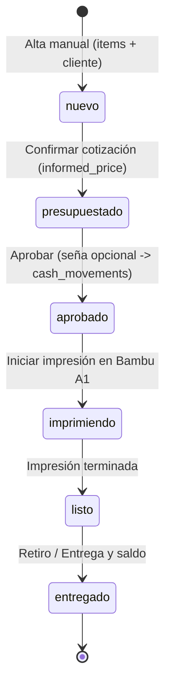

# Living Specification: orders

> **The source of truth for what the `orders` domain does right now.**
> Every requirement is written in declarative business language.
> Updated across changes: `order-intake`, `quote-calculation`, `order-lifecycle`, `refactor-money-domain-solid`.

## Purpose
Gestionar la recepción manual de pedidos de impresión 3D (Bambu Lab A1), la cotización automática basada en variables del laminador y del taller bajo un esquema relacional normalizado (1FN-4FN), y el avance secuencial a través de los estados del ciclo de vida productivo con auditoría completa de transiciones e integración con caja para señas.

---

## Active Requirements

### Requirement: Manual Order Intake (Alta Manual de Pedidos)
El sistema DEBE permitir registrar un nuevo pedido asociando un cliente existente (`client_id`) o creando uno nuevo inline (`client: {name, origin, phone, ...}`), junto con una o más piezas (`items: [{material_id, piece_description, weight_g, print_time_minutes, quantity}]`).
- El estado inicial de la orden DEBE ser `nuevo`.
- DEBE crearse atómicamente un registro inicial en `order_status_history` (`from_status=None, to_status="nuevo"`).
- Se DEBE validar atomicidad, tipos de datos y existencia de los materiales referenciados.
- Cada ítem registra su peso (`weight_g`) con precisión de hasta 3 decimales (`DECIMAL(10, 3)`), permitiendo fracciones de gramo (miligramos) tanto en la interfaz de usuario como en base de datos.
- Cada ítem DEBE indicar filamento o material; sin ninguno de los dos se rechaza con 422 (`items[i].filament_id`).
- Costo por kg del ítem: el informado en el ítem; si no, el del material; si el ítem solo indica filamento, 18000.00 (`DEFAULT_MATERIAL_COST_PER_KG`). Aplica igual en alta y en edición. Un costo informado de 0 (número o texto) se rechaza con 422 en `items[i].material_cost_per_kg`; nunca cae al valor por defecto.

### Requirement: Quote Calculation & Confirmation (Cotización y Presupuestación)
El sistema DEBE permitir calcular y recalcular el costo de producción y precio sugerido de venta para un pedido en cualquier estado del ciclo de vida productivo (`nuevo`, `presupuestado`, `aprobado`, `imprimiendo`, `listo`), recibiendo o ajustando los parámetros de taller (`quote_vars`: impresora seleccionada, merma/purga %, potencia de máquina, costo kWh, amortización/hora, tarifa de mano de obra por hora, tiempo de mano de obra en minutos, margen multiplicador).
- Los valores predeterminados se precargan desde `workshop_settings` y la impresora por defecto de `printers`, pero el operador puede ajustarlos individualmente por orden.
- El costo de filamento se calcula por cada pieza según el costo por kg de su respectivo material (`materials.cost_per_kg`) más la merma/purga.
- El costo de mano de obra se calcula proporcionalmente al tiempo humano: `labor_cost = labor_cost_per_hour * (labor_time_minutes / 60)`.
- Los montos derivados (`production_cost`, `suggested_sale_price`, `filament_cost`, `electricity_cost`, `machine_cost`, `labor_cost`) se calculan on-read dinámicamente y NUNCA se persisten en la base de datos (cumplimiento estricto de 3FN).
- Al confirmar la cotización con un precio informado (`POST /api/orders/<id>/quote/confirm`), si la orden está en estado `nuevo`, avanza a `presupuestado` guardando el precio y registrando la transición en `order_status_history`. Si ya se encuentra en un estado posterior, actualiza el precio informado y los parámetros de cotización preservando su estado actual. El precio informado DEBE ser un número finito, mayor a 0, dentro de DECIMAL(10,2) y con a lo sumo 2 decimales; si no, 422 en `informed_price`.
- En el tablero operativo (Kanban), cada tarjeta dispone de un botón directo de calculadora y enlace sobre el precio para acceder y recalcular la cotización en cualquier momento.

### Requirement: Order Lifecycle Transitions (Ciclo de Vida del Pedido)
El sistema DEBE permitir a los operadores autenticados avanzar secuencialmente el estado de una orden presupuestada según la máquina de estados:
`presupuestado` ➔ `aprobado` ➔ `imprimiendo` ➔ `listo` ➔ `entregado`.
- No se permiten saltos de estado ni reversiones.
- Al aprobar (`/approve`), se puede recibir un `deposit_amount` (seña) opcional: número finito, ≥ 0, dentro de DECIMAL(10,2) y con a lo sumo 2 decimales (si no, 422). Si es mayor a 0, crea atómicamente un ingreso vinculado a la **categoría de sistema** `seña`, con el operador que aprueba y la descripción "Seña inicial pedido #<id>".
- Al entregar (`/deliver`) con `collect_balance=true`, cobra el saldo pendiente (o `final_payment_amount`, que debe ser finito, > 0, con a lo sumo 2 decimales y ≤ saldo pendiente; si no, 422 sin cambiar el estado). Si el monto a cobrar es mayor a 0, crea atómicamente un ingreso vinculado a la **categoría de sistema** `saldo_pedido` ("Cobro saldo entrega pedido #<id>"). Con saldo 0 y sin monto, entrega sin movimiento.
- Si la categoría de sistema necesaria (`seña` / `saldo_pedido`) no existe, está inactiva o no está marcada como de sistema, la transición se rechaza con 409 (`error` menciona el código de la categoría) sin cambiar estado, movimientos ni historial. Una categoría de usuario con nombre parecido no la reemplaza.
- En cualquier otro endpoint de transición, el envío de `deposit_amount` es rechazado con error 422.
- Las transiciones usan guarda optimista para prevenir condiciones de carrera concurrentes.
- El estado `entregado` es terminal y rechaza cualquier transición posterior con error 409.

### Requirement: Order History and Tracking (Consulta y Trazabilidad)
El sistema DEBE permitir consultar el detalle de una orden, su estado actual y la lista cronológica completa de cambios de estado registrados en `order_status_history`.

### Requirement: Order Deletion (Eliminación de Pedidos)
El sistema DEBE permitir a los operadores autenticados eliminar permanentemente una orden (`DELETE /api/orders/<int:order_id>`) en cualquier estado del ciclo de vida productivo (`nuevo`, `presupuestado`, `aprobado`, `imprimiendo`, `listo`, `entregado`).
- Al eliminar una orden, sus ítems (`order_items`), cotizaciones asociadas (`order_quotes`) y el historial de transiciones (`order_status_history`) DEBEN ser eliminados en cascada (`delete-orphan`).
- Para preservar el arqueo físico de caja y la integridad de la 1FN a 4FN/BCNF, cualquier movimiento financiero registrado en `cash_movements` (como señas o saldos de entrega) asociado a la orden DEBE desvincularse atómicamente estableciendo `order_id = NULL` (`ON DELETE SET NULL`), garantizando que el dinero físico en gaveta y el balance acumulado de caja no se alteren.
- Tanto en la vista de tablero operativo (Kanban) como en la tabla de pedidos, la interfaz de usuario DEBE requerir una confirmación explícita mediante un modal antes de ejecutar la eliminación, informando al usuario el número de orden, cliente, estado actual y una advertencia clara sobre la irreversibilidad de la acción.

---

## State Diagram

